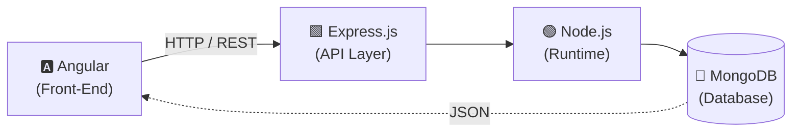

<!-- Header banner (animated wave) -->

<!-- Animated typing text -->

 

<!-- Social badges -->

  

---

## 👨‍💻 About Me

- 🎨 I design in **Figma** and build responsive, pixel-accurate interfaces
- ⚛️ Building with **Angular** and **React**, now going full-stack with the **MEAN stack**
- 🎓 CS graduate (Aviation Information Systems), **Zagazig National University**
- 💼 Looking for a **junior UI/UX or front-end role** (on-site, hybrid or remote)

---

## 🛠️ Tech & Tools

### 🎨 Design

### 🖥️ Front-End

### ⚙️ MEAN Stack (Back-End)

### 🧰 Tools

### 🔗 The MEAN Stack

> ⚛️ I also work with **React** for component-driven UIs, so I can pick the right tool for each project.

---

## 🚀 Featured Projects

| Project | Description | Focus |
| :-- | :-- | :-- |
| ✈️ **TRAVORA** | Real-time flight & baggage tracking platform | `UI/UX` |
| ⚽ **KYX** | Sports pitch booking app | `UI/UX` |
| 👟 **PUMA** | E-commerce redesign | `UI/UX` · `Front-End` |

👉 See the full case studies on my [Portfolio](https://eyadtamim.github.io) and [Behance](https://www.behance.net/eyadtamiim).

---

## 📊 GitHub Stats

---

<picture>
  <source media="(prefers-color-scheme: dark)" srcset="https://raw.githubusercontent.com/Eyadtamim/Eyadtamim/output/github-snake-dark.svg" />
  <source media="(prefers-color-scheme: light)" srcset="https://raw.githubusercontent.com/Eyadtamim/Eyadtamim/output/github-snake.svg" />
  
</picture>

---

### 📫 Let's build something great together

